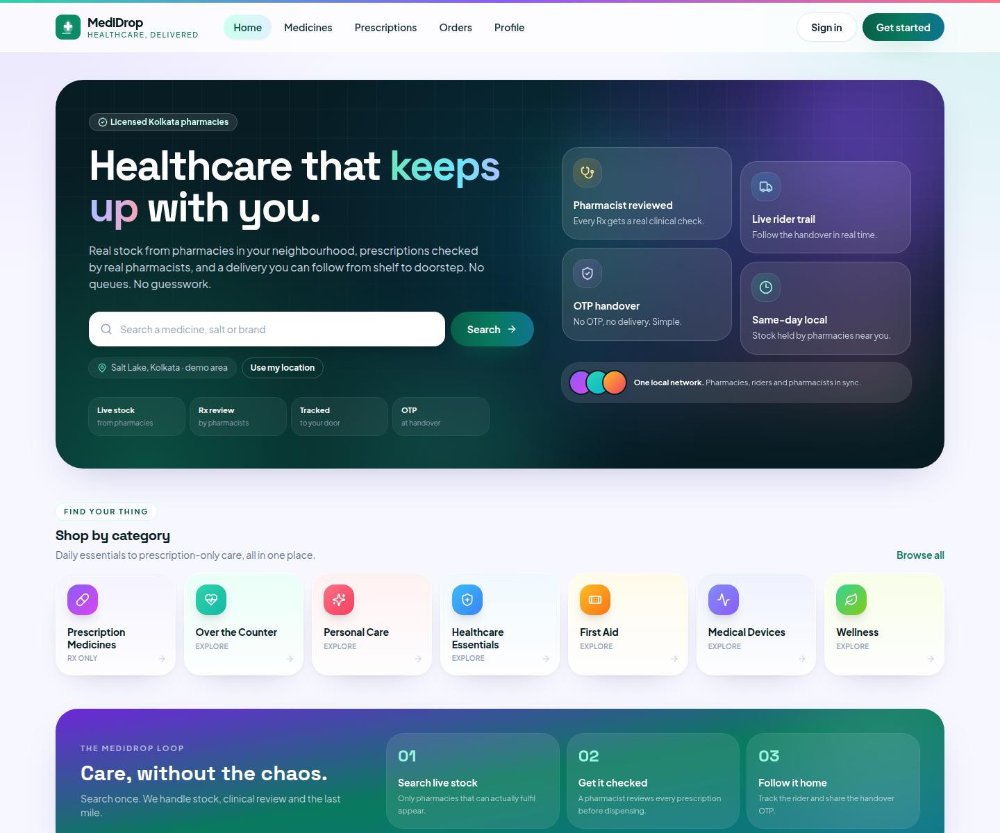
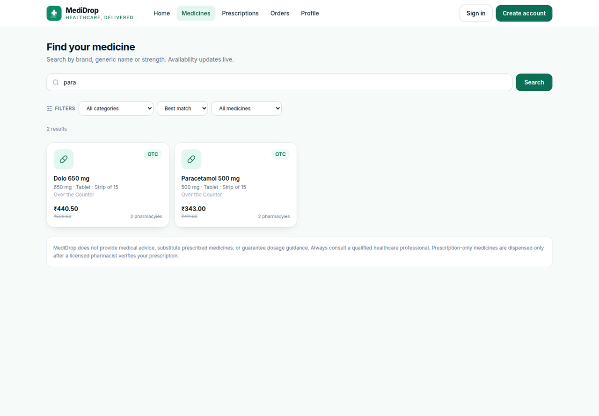
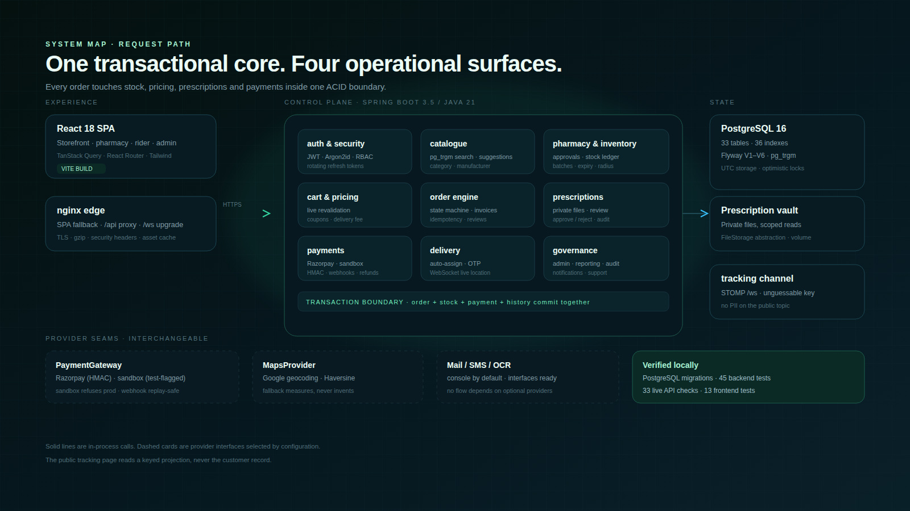
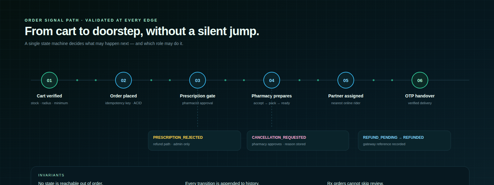
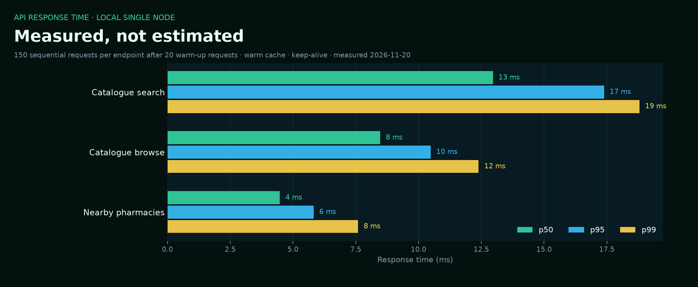
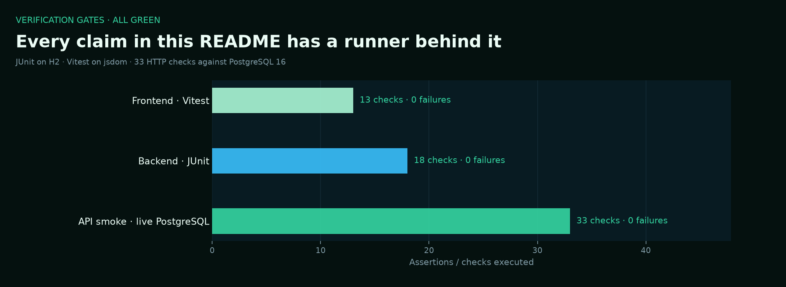

<p align="center">
  
</p>

<p align="center">
  <a href="https://github.com/officialarghya29/MediDrop/actions/workflows/ci.yml"></a>
  <a href="https://github.com/officialarghya29/MediDrop/releases"></a>
  
  
  
  
  
</p>

<p align="center">
  
</p>

<p align="center">
  <b>A verified local health network.</b><br/>
  Live pharmacy stock · pharmacist-reviewed prescriptions · OTP-verified delivery · full audit trail.
</p>

<p align="center">
  <a href="#inside-the-product">Product</a> ·
  <a href="#proof-not-promises">Measured results</a> ·
  <a href="#system-map">Architecture</a> ·
  <a href="#quick-start">Quick start</a> ·
  <a href="#documentation">Documentation</a>
</p>

---

## The 30-second version

**Current release:** [v0.1.1 — foundation hardening (pre-release)](https://github.com/officialarghya29/MediDrop/releases/tag/v0.1.1).
It is verified by CI but is **not** a pilot or `1.0.0` release; the launch gates are listed in
[Versions](docs/VERSIONS.md) and [Progress](docs/PROGRESS.md).

MediDrop is a production-shaped hyperlocal medicine delivery platform built for Kolkata. A customer searches
medicine stock held by licensed pharmacies nearby, uploads a prescription when required, and receives the
order through a tracked rider. Pharmacies fulfil, riders deliver, administrators govern.

**What makes it different from a catalogue with a checkout button:**

| Signal | What it means |
| --- | --- |
| **Real local stock** | Every cart line is re-priced and re-validated against a pharmacy's ledger before the order is accepted. |
| **Clinical gate** | Prescription-only items cannot be dispensed until a registered pharmacist approves the uploaded prescription. |
| **One order truth** | A single state machine authorises every transition, for every role, and appends it to history. |
| **Provable delivery** | Handover requires the customer's OTP; the public tracking page exposes status, never personal data. |
| **Governed money** | Gateway signatures are verified server-side, refunds are admin-only, and test payments are permanently flagged. |

> MediDrop does not provide medical advice or substitute prescribed medicines. Prescription-only medicines
> are dispensed only after review by a registered pharmacist.

---

## Inside the product

These are live screenshots of this repository running against its own API and seeded PostgreSQL data — not
mockups.

<table>
  <tr>
    <td width="50%"></td>
    <td width="50%"></td>
  </tr>
  <tr>
    <td align="center"><sub><b>Storefront</b> — live categories, nearby stock, current prices</sub></td>
    <td align="center"><sub><b>Search</b> — fuzzy matching, Rx/OTC filters, per-pharmacy pricing</sub></td>
  </tr>
  <tr>
    <td></td>
    <td></td>
  </tr>
  <tr>
    <td align="center"><sub><b>Admin console</b> — orders, revenue, approvals, support from the live database</sub></td>
    <td align="center"><sub><b>Pharmacy console</b> — fulfilment queue, prescription review, inventory, analytics</sub></td>
  </tr>
</table>

<p align="center">
  
  <br/>
  <sub><b>Public tracking</b> — keyed by an unguessable token, showing rider position and ETA without exposing an account.</sub>
</p>

---

## Why hyperlocal wins

The model is simple: **move the pharmacy to the patient, not the patient to the pharmacy.** Three distances
decide whether that works.

| Distance | The problem | MediDrop's answer |
| --- | --- | --- |
| **Physical** | A medicine 20 km away is not urgent care. | Pharmacies are discovered by delivery radius and ranked by real distance. |
| **Clinical** | Speed is dangerous without pharmacist oversight. | Rx items wait for a registered pharmacist's decision before fulfilment. |
| **Operational** | Stock shown online rarely matches the shelf. | Inventory is a ledger; carts and orders revalidate it server-side. |

The result is not “faster e-commerce”. It is a smaller loop: **search → verify → dispense → hand over**, with
each step owned by a role that is accountable for it.

---

## System map

<p align="center">
  
</p>

The API is a **modular monolith** on purpose. Placing an order touches stock, pricing, prescriptions, payment
state and history inside one ACID transaction. Splitting those into services would buy independent scaling
this product does not yet need, at the cost of distributed consistency. Modules are separated by package and
service boundaries today, so a future split has natural seams.

| Layer | Responsibility |
| --- | --- |
| **React SPA** | Storefront, pharmacy console, rider console, admin console; optimistic reads via TanStack Query. |
| **nginx edge** | SPA fallback, `/api` proxy, `/ws` upgrade, TLS, asset caching, security headers. |
| **Spring Boot core** | Auth, catalogue, pharmacy, inventory, cart, orders, prescriptions, payments, delivery, governance. |
| **PostgreSQL 16** | Flyway-owned schema, 34 tables, 94 indexes, trigram search, optimistic locking. |
| **Prescription vault** | Private files behind an authenticated, role-scoped streaming endpoint. |
| **Provider seams** | Payment, maps, mail, SMS, OCR and storage are interfaces; the system runs without credentials. |

### One order, six signals

<p align="center">
  
</p>

Three invariants hold at every edge:

1. **No state is reachable out of order.** All transitions pass through `OrderStateMachine`; unknown edges are rejected with `409`.
2. **Role and resource are checked separately.** A pharmacist may accept an order — but only their own pharmacy's order.
3. **Every transition is evidence.** History stores `from`, `to`, actor role, reason and timestamp, and customers can see it.

Full rules: [docs/order-lifecycle.md](docs/order-lifecycle.md).

---

## Proof, not promises

<p align="center">
  
</p>

Measured on the running stack: Spring Boot 3.5.16 on Java 21, PostgreSQL 16 in Docker, warm cache, HTTP
keep-alive, **150 sequential requests per endpoint after 20 warm-up requests**. Raw data is committed in
[`docs/assets/measurements.json`](docs/assets/measurements.json) and reproducible with
`infrastructure/scripts/generate-report-assets.py`.

| Endpoint | p50 | p95 | p99 | Sequential throughput |
| --- | ---: | ---: | ---: | ---: |
| `GET /medicines/search` | 13.0 ms | 17.4 ms | 18.8 ms | ~76 req/s |
| `GET /medicines` | 8.5 ms | 10.5 ms | 12.4 ms | ~117 req/s |
| `GET /pharmacies/nearby` | 4.5 ms | 5.8 ms | 7.6 ms | ~218 req/s |

> **Read this honestly:** these are local single-node numbers on a development machine with a demo dataset.
> They prove the request path is lean, not that production will hit these figures. Capacity must be validated
> against real catalogue size, network latency and concurrent load before launch.

### Quality gates

<p align="center">
  
</p>

| Gate | Command | Executed | Result |
| --- | --- | ---: | --- |
| Live API smoke | `infrastructure/scripts/smoke-test.sh` | 33 checks | **33 passed, 0 failed** |
| Backend | `cd backend && mvn test` | 37 tests | **37 passed, 0 failed** |
| Frontend | `cd frontend && npm test` | 13 tests | **13 passed, 0 failed** |
| Production build | `cd frontend && npm run build` | 1 bundle | **Typecheck + build passed** |
| Compose validation | `docker compose config` | 3 services | **Valid** |

The smoke suite is not a happy-path script. It proves anonymous requests get `401`, a customer gets `403` on
admin routes, COD orders move through pharmacy acceptance and preparation, delivery auto-assignment works,
handover fails without the OTP, sandbox payments reconcile back to the order, and admin reporting reflects
the newly created data.

**Bugs caught by this validation, not hidden:** unfiltered catalogue browse returned `500` on PostgreSQL
because Hibernate bound a null search term as `bytea`, breaking `lower(?)`. The fix coalesces the term in JPQL;
it is covered by `MedicineSearchTest` and two smoke checks (browse and term-less search), which is why the suite
runs **33** checks, not 31.

A later stabilization pass tightened the product paths around it: public tracking now resolves through the
indexed tracking key instead of scanning the orders table; the Active, Delivered and Cancelled tabs filter and
paginate in SQL (they previously fell through to an unfiltered list); status counts are database counts; stock
restoration, coupon redemption, refresh-token rotation and refunds take row locks so concurrent requests cannot
lose updates; and the H2 test schema now initialises every table instead of silently skipping `coupons`.
`OrderQueryTest` covers the filters, counts and tracking lookup. A follow-up audit found and fixed the last
unhandled enum filters (admin approvals and prescription queues now return `400`), stopped platform reports
from loading every order and assignment in memory, and made the public tracking projection reveal only the
city and a neighbourhood-level coordinate — never the street address. A cancellation audit then found that
stock and coupon capacity were only released on one cancellation path; `V4` adds idempotent release markers
and `OrderReleaseTest` proves that cancellation and prescription rejection put both back exactly once. The
storefront also gained a real pharmacy filter — the link previously carried a query parameter the API ignored.
`AdminQueryTest` guards the admin filter path. CI now compiles from a clean checkout and runs the live smoke
suite on PostgreSQL.

---

## Engineering decisions, compared

| Decision | Alternative | Why this codebase chose it |
| --- | --- | --- |
| Modular monolith | Microservices per domain | One transaction for order + stock + payment; operational simplicity for a city-scale launch. |
| Server revalidates the cart | Trust client-side totals | Prevents oversell, stale prices, out-of-radius delivery and paused pharmacies. |
| Opaque rotating refresh tokens | Long-lived JWT | Refresh tokens are hashed at rest and revocable; access tokens stay short-lived. |
| Unguessable tracking key | Order ID in the URL | A public link cannot enumerate other customers' deliveries. |
| Sandbox payment default | Live gateway by default | The stack boots safely with no secrets; live mode is an explicit, auditable choice. |
| Haversine distance default | Require a maps API key | Distance works offline; the fallback refuses geocoding instead of inventing coordinates. |
| Ledger for stock | Mutable stock column only | Every change has an actor, reason and balance; reconciliation is possible. |

### Provider modes, without theatre

| Capability | Default in this repo | To go live | Verified here |
| --- | --- | --- | --- |
| Payments | Sandbox (HMAC verification, `is_test=true`) | Razorpay keys + webhook secret | Sandbox end-to-end; **live Razorpay not verified** |
| Maps | Haversine distance | Google server key | Distance verified; **geocoding not verified** |
| Email | Console provider | SMTP credentials | **Not verified** |
| SMS / OTP | Console provider | SMS gateway adapter | **Not implemented** |
| Prescription storage | Local private volume | S3-compatible adapter | Local verified; **S3 not implemented** |
| OCR | Disabled interface | OCR provider | **Not verified; never required for approval** |

Nothing in the core flow depends on a credential that is absent. That is deliberate: the platform is honest
about what is simulated, and the UI says so where it matters.

---

## Security is a feature, not a footnote

| Control | Implementation |
| --- | --- |
| Passwords | Argon2id with per-user salt |
| Access tokens | HS256 JWT, 15-minute lifetime, issuer-checked |
| Refresh tokens | Opaque 256-bit values, SHA-256 hashed at rest, rotated on every use |
| Authorisation | Endpoint role checks **plus** ownership/tenancy checks in services |
| Prescriptions | Private storage; file access scoped to owner, linked pharmacy or admin |
| Payments | Server-side signature verification, idempotent webhooks, refunds restricted to admins |
| Abuse prevention | Rate limits on login, OTP and password reset; generic error messages |
| Audit | Append-only rows for approvals, suspensions, refunds and status overrides |
| Transport | TLS termination, HSTS, nosniff, frame, referrer and permissions policies at nginx |
| Realtime | STOMP CONNECT requires an access token; tracking subscriptions are owner-scoped and client publishing is rejected |
| API schema | Swagger/OpenAPI disabled under the production profile unless `MEDIDROP_OPENAPI_ENABLED=true` |

**Documented trade-off:** the SPA stores tokens in `localStorage` to keep the API stateless. Short access-token
lifetimes and refresh rotation limit exposure; cookie-based sessions with CSRF protection are the stricter
alternative. Details: [docs/architecture.md](docs/architecture.md#security-model).

---

## Stack

| Layer | Technology |
| --- | --- |
| API | Java 21, Spring Boot 3.5.16, Spring Security, Spring Data JPA, Bean Validation, Springdoc |
| Data | PostgreSQL 16, Flyway, trigram indexes, H2 for tests |
| Auth | Argon2id, JJWT, rotating opaque refresh tokens |
| Web | React 18, TypeScript 5.6, Vite 8, Tailwind CSS 3, TanStack Query 5, React Router 7, Zustand, React Hook Form + Zod |
| Realtime | STOMP over native WebSocket |
| Delivery | Multi-stage Docker images, nginx, GitHub Actions |

---

## Quick start

### Docker Compose — the whole stack

```bash
cp .env.example .env
# required: MEDIDROP_JWT_SECRET (openssl rand -base64 48) and strong DB passwords
docker compose up -d --build
docker compose ps
```

| Surface | URL |
| --- | --- |
| Web app | <http://localhost:3000> |
| API | <http://localhost:8080> |
| OpenAPI UI | <http://localhost:8080/swagger-ui.html> (local dev; disabled in prod by default) |
| Health | <http://localhost:8080/actuator/health> |

The compose profile is `prod`: demo seeding is disabled, sandbox payments are the default, and live
providers require explicit credentials.

### Local development

**Prerequisites:** Java 21, Maven 3.9+, Node 22.12+, PostgreSQL 16.

```bash
createdb medidrop

# API — dev profile seeds a demo Kolkata network
cd backend
MEDIDROP_JWT_SECRET=dev-only-medidrop-secret-change-before-deploy-9f3c1a \
MEDIDROP_SEED_ENABLED=true \
mvn spring-boot:run

# Web — proxies /api and /ws to :8080
cd frontend
npm install
npm run dev
```

### Demo accounts

Seeded only when `MEDIDROP_SEED_ENABLED=true`. Demo rows are flagged and must never be treated as production
data.

| Role | Email | Password |
| --- | --- | --- |
| Administrator | `admin@medidrop.local` | `Admin@12345` |
| Customer | `customer@medidrop.local` | `Demo@12345` |
| Pharmacy | `pharmacy@medidrop.local` | `Demo@12345` |
| Pharmacy (second) | `pharmacy2@medidrop.local` | `Demo@12345` |
| Delivery partner | `delivery@medidrop.local` | `Demo@12345` |
| Delivery partner (second) | `delivery2@medidrop.local` | `Demo@12345` |

---

## Repository map

```text
MediDrop/
├── backend/
│   ├── src/main/java/com/medidrop/       auth · catalogue · pharmacy · inventory · cart ·
│   │                                     order · prescription · payment · delivery ·
│   │                                     admin · reporting · notification · support · audit
│   ├── src/main/resources/db/migration/  V1 schema · V2 indexes · V3 trigram search · V4 release markers
│   ├── src/test/java/com/medidrop/       state machine · pricing · auth · payments · search
│   └── Dockerfile
├── frontend/
│   ├── src/features/                     auth · customer · pharmacy · delivery · admin
│   ├── src/components/                   shell · UI primitives · map · medicine card
│   ├── src/test/                         Vitest setup and tests
│   ├── nginx.conf
│   └── Dockerfile
├── docs/
│   ├── assets/                           diagrams, screenshots, charts, measurements.json
│   ├── architecture.md · api.md · order-lifecycle.md · deployment.md · testing.md
├── infrastructure/scripts/               smoke-test.sh · generate-report-assets.py
├── .github/workflows/ci.yml
├── docker-compose.yml
├── LICENSE
└── .env.example
```

**API shape:** `/api/v1`, envelope `{ success, message, data, timestamp }`, OpenAPI at `/swagger-ui.html`
under the development profile. Full endpoint catalogue: [docs/api.md](docs/api.md).

---

## Documentation

| Document | What it answers |
| --- | --- |
| [Architecture](docs/architecture.md) | How the modules fit, what stays consistent, where providers plug in |
| [Order lifecycle](docs/order-lifecycle.md) | Every state, transition, role, cancellation and refund rule |
| [Versions](docs/VERSIONS.md) | Pre-pilot SemVer, milestone tags and checkpoint rules |
| [Releases](https://github.com/officialarghya29/MediDrop/releases) | Published pre-releases, notes and downloadable artifacts |
| [API reference](docs/api.md) | Conventions and the complete endpoint catalogue |
| [Deployment](docs/deployment.md) | Docker, environment matrix, operations, go-live checklist |
| [Testing](docs/testing.md) | Test layers, commands, coverage and known gaps |

---

## Integration status and next moves

| Status | Item |
| --- | --- |
| Verified | PostgreSQL migrations, API boot with seed data, 37 backend tests, 33-check smoke suite, 13 frontend tests, production bundle, compose configuration |
| Pending credentials | Live Razorpay payments and refunds; Google Maps geocoding; SMTP email |
| Pending implementation | SMS gateway, S3 storage adapter, OCR provider, push notifications |

**Roadmap:** provider sandbox certification · SMS OTP delivery · encrypted object storage for prescriptions ·
Redis-backed rate limiting and WebSocket fan-out · city-by-city catalogue and delivery zones · accessibility
audit and Bengali/Hindi localisation.

---

## License

MediDrop is proprietary software. Copyright © 2026 MediDrop Team. All rights reserved.
No part of the code, documentation, designs or brand assets may be copied, modified, distributed or used
without prior written permission. The full terms are in [LICENSE](LICENSE).

---

<p align="center">
  <sub>Built for hyperlocal healthcare in India · Kolkata, West Bengal · 22.5726° N, 88.3639° E</sub>
</p>
