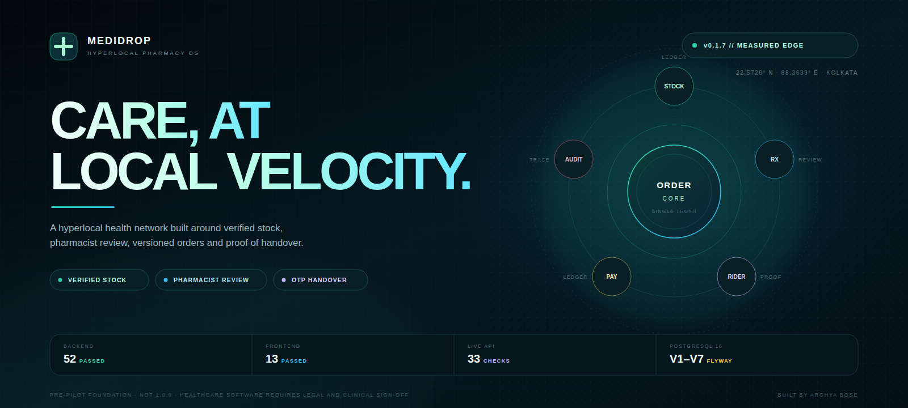
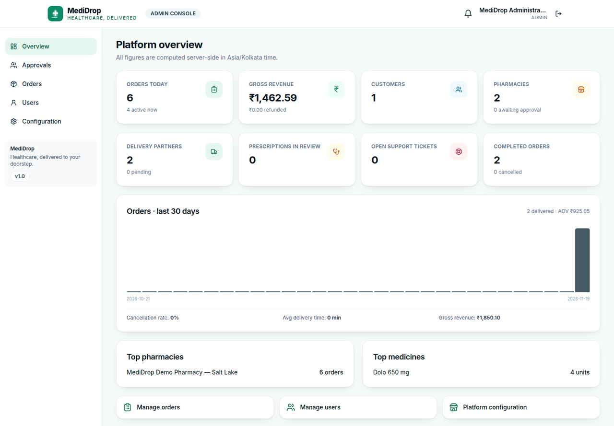
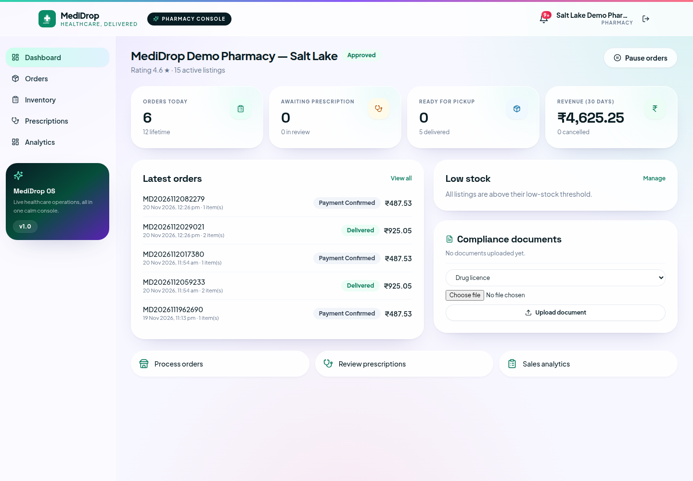
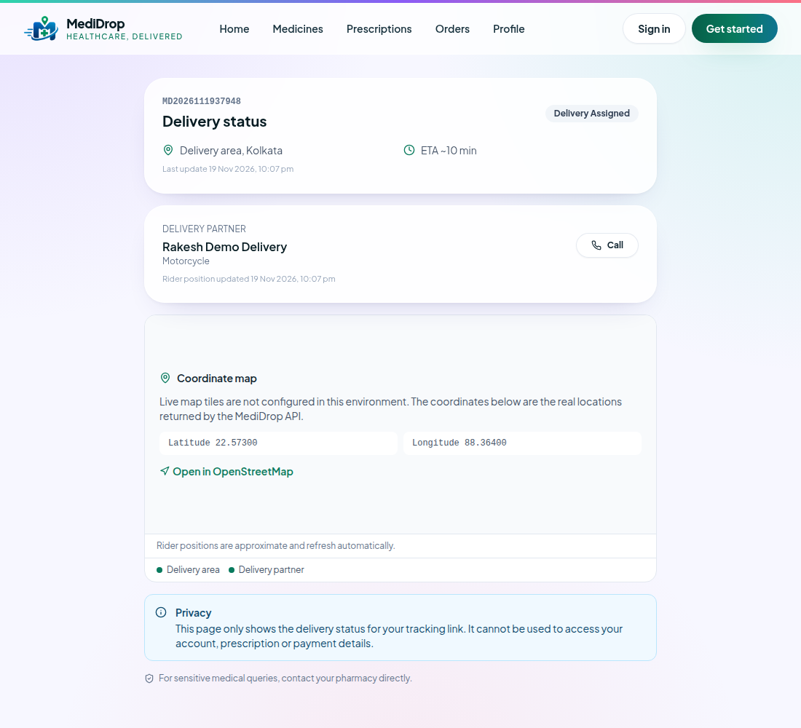

<p align="center">
  
</p>

<p align="center">
  <a href="https://github.com/officialarghya29/MediDrop/actions/workflows/ci.yml"></a>
  <a href="https://github.com/officialarghya29/MediDrop/releases"></a>
  
  
  
  
  
  
</p>

<h3 align="center">MEDIDROP // HYPERLOCAL PHARMACY OS</h3>

<p align="center">
  <b>One city. One network. One order truth.</b><br/>
  Verified stock · pharmacist-reviewed prescriptions · versioned order state · OTP handover.
</p>

<p align="center">
  <a href="#00--current-signal">Signal</a> ·
  <a href="#01--the-operating-loop">Model</a> ·
  <a href="#03--system-topology">Architecture</a> ·
  <a href="#05--verification-deck">Verification</a> ·
  <a href="#06--launch-it">Launch</a> ·
  <a href="#08--release-rail">Releases</a>
</p>

---

> **STATUS / 0.1.8 — pre-pilot foundation.** This is a working, CI-verified system, not a
> `1.0.0` claim and not a licensed pharmacy service. Live provider certification, multi-instance
> load, keyboard/screen-reader/touch-target audits, legal review and operations sign-off remain
> open. The honest boundary is documented in [Versions](docs/VERSIONS.md),
> [Progress](docs/PROGRESS.md) and [Audit](docs/AUDIT.md).

## / 00 · CURRENT SIGNAL

| Signal | Reading |
| --- | --- |
| **Release** | `0.1.8` mainline patch · latest tag `v0.1.7` |
| **Continuity** | `v0.1.6` runtime hardening → `v0.1.7` 250K search → `0.1.8` soak, authenticated axe, Lighthouse |
| **Backend** | **52 passed, 0 failed** |
| **Frontend** | **13 passed, 0 failed** |
| **Browser + axe** | **16 passed, 0 failures** · Chrome · 390 px |
| **Live API** | **33 checks, 0 failed** against PostgreSQL 16 |
| **Search p95** | **280.5 ms** at **250K** medicines, 100 requests |
| **Order p95** | **51.6 ms** across **31** real cross-node COD orders in the CI soak |
| **Sustained search** | **4,913 requests across 2 instances · p95 11.5 ms · 0 errors** |
| **Lighthouse mobile** | **91 home / 92 search performance · 100 accessibility** (median of 3) |
| **Stock race** | **50 concurrent checkouts on stock 10 → 10 orders, 0 oversold** |
| **Schema** | **33 tables · 37 indexes · Flyway V1–V7** |
| **Dependencies** | `npm audit --omit=dev`: **0 vulnerabilities** |
| **Surface** | React SPA → nginx → Spring Boot → PostgreSQL |
| **Region** | Kolkata, West Bengal · `22.5726° N, 88.3639° E` |

### The 0.1.8 follow-up pass

This patch closes the three gates left open by 0.1.7 without changing the release tag:

- **Two-instance search and order load is measured.** CI now starts two API processes against one
  PostgreSQL database. `soak-check.py` distributes three search workers across both nodes and adds
  each COD order on one node before submitting it on the next. The CI run completed **4,913
  searches** at p95 **11.5 ms** and **31 orders** at p95 **51.6 ms**, zero errors; a local per-node
  run recorded 2,132 / 2,131 searches at p95 **16.8 ms** and orders at p95 **93.9 ms**.
- **All customer and role surfaces have automated axe coverage.** The Playwright gate checks 16
  journeys: public home, search, medicine detail, sign-in and search-to-detail, plus cart, checkout,
  orders, order detail, prescriptions, profile, notifications, public tracking, pharmacy, delivery
  and admin. Result: **16 passed**, zero WCAG A/AA violations.
- **Lighthouse is measured against explicit median thresholds.** Pinned Lighthouse 12.8.2 runs three
  mobile samples on the built app against the real API. Median: home **91 performance / 100
  accessibility**, search **92 / 100**; the runner now fails below 90 performance, 100 accessibility,
  100 best-practices or 90 SEO. It remains a manual gate because a prior run varied as low as 82.
- **Three real defects were fixed.** Lighthouse found an h1 → h3 heading-order jump on search
  results; the expanded axe gate found a notification button whose accessible name omitted its
  visible unread count and a support-ticket timestamp with sub-AA contrast. No rule was disabled.

### The 0.1.7 measured-edge pass

This release turns two previously open claims into repeatable gates and applies the deferred
dependency batch:

- **250K catalogue search is measured.** `catalogue-load-check.py` seeds 250,000 medicines plus one
  inventory row each, then measures 100 real HTTP searches. The first run exposed a concrete index
  mismatch; V7 adds lowercased trigram expression indexes and a prefix index. p95 is now **280.5 ms**
  against the **300 ms** target, with p50 189.1 ms and 0 errors.
- **Browser and axe journeys gate CI.** The gate began with five public checks at 390 px: home,
  search, medicine detail, sign-in and a search-to-detail journey. WCAG A/AA axe violations fail the
  required frontend job. It found and fixed the logo accessible-name mismatch instead of suppressing
  the rule; 0.1.8 extended the same gate to 16 journeys.
- **Deferred minor/patch dependencies are applied.** React Query, Zustand, TypeScript,
  Testing Library, Autoprefixer and Springdoc are current; production npm audit remains at zero.

### The 0.1.6 hardened-edge pass

This release closed the remaining session, tenancy and runtime edges found after the 0.1.5
state-authority pass:

- **Suspended providers lose realtime access immediately.** Pharmacy tracking subscriptions require
  an approved, active pharmacy, and rider delivery/tracking subscriptions require an approved rider.
- **Inactive pharmacies cannot receive new prescriptions.** Prescription upload now requires both
  approval and active state, not approval alone.
- **Orders require both contact channels verified.** A customer must verify email **and** mobile
  before checkout; one verified channel is no longer enough.
- **Shutdown is graceful.** In-flight requests get a 30-second drain, Hikari leak detection is on,
  JDBC writes batch at 30, and liveness/readiness probes are exposed for orchestration.
- **Dependency and branch controls are enforced.** Major dependency jumps are deferred to a
  migration, CI audits the production npm tree, and `main` rejects force-pushes/deletion while
  requiring all three CI jobs for pull requests. Admin direct pushes remain available for this
  single-maintainer release rail.

The 0.1.5 state-authority work remains:

- **Suspended riders lose write authority immediately.** Accepting, advancing or completing an
  existing delivery now requires an `APPROVED` partner, not merely a valid login.
- **Suspended pharmacies lose prescription access.** Review, queue and file reads require an active
  approved pharmacy; the profile may still cancel an existing order but cannot accept, prepare or
  hand over medicine.
- **Inventory writes require an active pharmacy.** Suspension cannot be bypassed through stock or
  catalogue maintenance endpoints.
- **The 50-way stock gate is measured, not promised.** A repeatable harness fired 50 simultaneous
  checkouts against a real PostgreSQL 16 instance with stock 10: exactly 10 won, 40 received `409`,
  stock reached 0 and 10 ledger units were sold.

Earlier lifecycle guards remain in place:

- **Locked accounts cannot mint sessions through OTP.** Verification now rejects locked, disabled
  and deletion-pending accounts before issuing tokens.
- **OTP and password-reset tokens are single-use under concurrency.** Both rows are taken with a
  pessimistic write lock, so two simultaneous requests cannot both succeed.
- **Order transitions are version-guarded.** Every order carries an optimistic version; a stale
  cancellation, acceptance or refund attempt receives a recoverable `409` instead of silently
  overwriting the newer state.
- **A rejected rider no longer strands an order.** Reassignment replaces the rider while the order
  remains `DELIVERY_ASSIGNED`; it no longer expects the order to travel backwards to
  `READY_FOR_PICKUP`.
- **The demo console reports the real version.** The stale `v1.0` label is gone.

These changes do not make the product "perfect". They remove specific ways the model could lie about
stock, identity or order state.

---

## / 01 · THE OPERATING LOOP

```text
        SEARCH                 VERIFY                 DISPENSE                PROVE
   live pharmacy stock  →  Rx + licensed review  →  pharmacy fulfilment  →  OTP handover
          │                     │                       │                      │
      price ordered        scoped access            locked ledger          audit + history
```

| Stage | What the system refuses to do |
| --- | --- |
| **Search** | Show a paused, suspended or out-of-radius pharmacy as an orderable source. |
| **Verify** | Let a prescription-only item pass without a verified pharmacist decision. |
| **Dispense** | Accept a cart line whose price, stock or pharmacy changed after it was added. |
| **Hand over** | Mark delivered without the customer's current four-digit code. |
| **Refund** | Jump an order to `REFUNDED` without a captured payment and a refund ledger record. |

### Substitute comparison

Lower-cost equivalents are a **comparison aid**, not automatic substitution. The API only compares
products with identical generic composition, strength, dosage form, pack size, prescription flag and
schedule class. The candidate must be in stock at the selected pharmacy, strictly cheaper, and not
sales-blocked. Prescription alternatives stay behind pharmacist review.

When no pharmacy is supplied, MediDrop walks price-ordered stock until it finds the cheapest
**approved, active, accepting** pharmacy. A paused cheapest listing cannot hide a valid match.

---

## / 02 · THE INVARIANTS

| Invariant | Enforcement |
| --- | --- |
| **One order truth** | Every transition passes through `OrderStateMachine`; history records from, to, actor, reason and time. |
| **One writer wins** | Orders use an optimistic version; stock, coupons, payments and refresh tokens use row locks where a race would lose value. |
| **Tenant is not a parameter** | Pharmacy invoices, reviews and prescription files resolve the caller's pharmacy server-side. |
| **Money is server-side** | Totals, discounts, delivery fees, tax and refund ceilings are recomputed by the API. |
| **Identity is checked twice** | Endpoint roles plus ownership/tenancy checks inside services. |
| **Public means minimal** | Tracking exposes status, city, neighbourhood-level coordinates and a masked rider phone — never the street address. |
| **Demo is visible** | Sandbox payments are `is_test=true`; seeded records are marked as demo where the schema supports it. |

### Concurrency, explicitly

The current model does not claim that every race is solved. It makes the important races **safe to
retry**:

```text
checkout     → inventory row lock in deterministic order → one stock winner
coupon       → coupon row lock before redemption → usage cannot exceed the limit
refresh      → refresh-token row lock before rotation → one rotation winner
refund       → payment row lock + ledger sum → refund cannot exceed captured amount
order status → optimistic version → stale writer gets 409, not a silent overwrite
OTP / reset  → token row lock → one successful consumption
```

The 50-way stock gate is now **measured**, and catalogue search has a measured 250K p95. Those are
bounded proofs, not a licence to claim the system is solved under sustained load or soak.

---

## / 03 · SYSTEM TOPOLOGY

<p align="center">
  
</p>

The core is a **modular monolith** on purpose. Placing an order touches stock, pricing, prescription
state, payment state and history inside one ACID transaction. Splitting those into services would buy
independent scaling this product does not yet need, at the cost of distributed consistency.

| Layer | Responsibility |
| --- | --- |
| **React 18 SPA** | Storefront, pharmacy console, rider console, admin control tower. |
| **nginx edge** | SPA fallback, `/api` proxy, `/ws` upgrade, TLS and security headers. |
| **Spring Boot 3.5.16** | Auth, catalogue, inventory, cart, orders, prescriptions, payments, delivery, governance. |
| **PostgreSQL 16** | Flyway-owned schema, trigram search, optimistic locks, ledger tables. |
| **Prescription vault** | Private files behind an authenticated, role-scoped streaming endpoint. |
| **Provider seams** | Payments, maps, mail, SMS, OCR and storage are interfaces; the stack boots without credentials. |

### Source shape

```text
backend/src/main/java/com/medidrop/
  auth/          identity, OTP, rotating refresh tokens
  medicine/      catalogue, search, substitute comparison
  inventory/     stock ledger, batches, expiry
  cart/          single-pharmacy cart and live revalidation
  order/         state machine, history, invoices, tracking
  prescription/  private upload, review, access control
  payment/       sandbox + Razorpay seam, webhooks, refunds
  delivery/      assignment, rider transitions, proof of handover
  admin/         approvals, settings, reports, audit
```

---

## / 04 · PRODUCT SURFACES

These are live screenshots of this repository against its own API and seeded PostgreSQL data.

<table>
  <tr>
    <td width="50%"></td>
    <td width="50%"></td>
  </tr>
  <tr>
    <td align="center"><sub><b>Storefront</b> — live categories, nearby stock, current prices</sub></td>
    <td align="center"><sub><b>Search</b> — fuzzy matching, Rx/OTC filters, per-pharmacy pricing</sub></td>
  </tr>
  <tr>
    <td></td>
    <td></td>
  </tr>
  <tr>
    <td align="center"><sub><b>Admin console</b> — orders, revenue, approvals, support from the live database</sub></td>
    <td align="center"><sub><b>Pharmacy console</b> — fulfilment queue, prescription review, inventory</sub></td>
  </tr>
</table>

<p align="center">
  
  <br/>
  <sub><b>Public tracking</b> — keyed by an unguessable token; status and a neighbourhood-level map, never an address book.</sub>
</p>

---

## / 05 · VERIFICATION DECK

<p align="center">
  
</p>

| Gate | Command | Executed | Result |
| --- | --- | ---: | --- |
| Backend | `cd backend && mvn test` | 52 tests | **52 passed, 0 failed** |
| Frontend | `cd frontend && npm test` | 13 tests | **13 passed, 0 failed** |
| Production build | `cd frontend && npm run build` | 1 bundle | **Typecheck + build passed** |
| Live API smoke | `infrastructure/scripts/smoke-test.sh` | 33 checks | **33 passed, 0 failed** |
| Browser + axe | `cd frontend && npm run test:e2e` | 16 journeys | **16 passed, 0 violations** |
| Two-instance soak | `infrastructure/scripts/soak-check.py --base-url … --base-url …` | 60 s | **4,913 searches · 31 orders · 0 errors** |
| Lighthouse | `infrastructure/scripts/lighthouse-check.py` | 3 mobile runs | **91 / 92 performance · 100 accessibility** |
| Stock race | `infrastructure/scripts/stock-race-check.py` | 50 checkouts | **10 winners · 40 conflicts · 0 oversold** |
| Compose validation | `docker compose config` | 3 services | **Valid** |
| Dependency audit | `npm audit --omit=dev` | production tree | **0 vulnerabilities** |

### What the regression suite specifically proves

- Locked accounts cannot verify an OTP or receive an access/refresh pair.
- A successful OTP is consumed once; replay is rejected.
- OTP and password-reset rows are loaded for update, not read-then-write.
- A suspended rider cannot accept a delivery that was assigned before suspension.
- Suspended pharmacies and riders lose realtime tracking/delivery subscriptions.
- A suspended or inactive pharmacy cannot review, open the queue, read history, read files or
  receive a new prescription upload.
- An order cannot be placed until both email and mobile are verified.
- A stale order write cannot overwrite a newer order version.
- A rejected rider is replaced without moving the order backwards.
- Fifty simultaneous checkouts against ten units produce exactly ten orders and no negative stock.
- Substitute filtering excludes different packs, Rx mismatches, blocked products, out-of-stock
  candidates and unavailable pharmacies.
- Cancellation and prescription rejection restore stock and coupon capacity exactly once.
- Cross-tenant invoices, review history and prescription files are refused.
- Refund terminal states require `REFUND_PENDING` and a ledger record.

### Bugs caught by validation, not hidden

This repository has a habit of documenting its own failures. Earlier passes caught a PostgreSQL
null-term browse `500`, invoice and review-history IDORs, a direct refund bypass, an OTP account
enumeration oracle, a paused-cheapest-pharmacy substitute dead end, a rider rejection that left
the order assigned forever, and suspended providers that could still advance assigned work. Each
fixed defect has a regression or a live reproduction note.

---

## / 06 · LAUNCH IT

### Docker Compose — the whole stack

```bash
cp .env.example .env
# required: MEDIDROP_JWT_SECRET and strong database passwords
docker compose up -d --build
docker compose ps
```

| Surface | URL |
| --- | --- |
| Web app | <http://localhost:3000> |
| API | <http://localhost:8080> |
| OpenAPI UI | <http://localhost:8080/swagger-ui.html> (local dev; disabled in prod by default) |
| Health | <http://localhost:8080/actuator/health> |

The compose profile is `prod`: demo seeding is disabled, sandbox payments are the default, and live
providers require explicit credentials.

### Local development

**Prerequisites:** Java 21, Maven 3.9+, Node 22.12+, PostgreSQL 16.

```bash
createdb medidrop

cd backend
MEDIDROP_JWT_SECRET=dev-only-medidrop-secret-change-before-deploy-9f3c1a \
MEDIDROP_SEED_ENABLED=true \
mvn spring-boot:run

cd ../frontend
npm install
npm run dev
```

### Demo accounts

Seeded only when `MEDIDROP_SEED_ENABLED=true`. Demo rows are flagged and must never be treated as
production data.

| Role | Email | Password |
| --- | --- | --- |
| Administrator | `admin@medidrop.local` | `Admin@12345` |
| Customer | `customer@medidrop.local` | `Demo@12345` |
| Pharmacy | `pharmacy@medidrop.local` | `Demo@12345` |
| Pharmacy (second) | `pharmacy2@medidrop.local` | `Demo@12345` |
| Delivery partner | `delivery@medidrop.local` | `Demo@12345` |
| Delivery partner (second) | `delivery2@medidrop.local` | `Demo@12345` |

---

## / 07 · SECURITY GRID

| Control | Implementation |
| --- | --- |
| Passwords | Argon2id with per-user salt |
| Access tokens | HS256 JWT, 15-minute lifetime, issuer checked |
| Refresh tokens | Opaque 256-bit values, SHA-256 hashed at rest, row-locked rotation |
| Authorisation | Endpoint roles **plus** ownership/tenancy checks |
| Prescriptions | Private storage; owner, active linked pharmacy or admin only |
| Payments | Server-side HMAC verification, idempotent webhooks, admin-only refunds |
| Account state | Locked, disabled and deletion-pending accounts are blocked at login, refresh and OTP |
| Provider suspension | Suspended riders and pharmacies cannot advance work, read prescription data or subscribe to realtime channels |
| Disclosure | Private reporting path in [SECURITY.md](SECURITY.md) |
| Abuse prevention | Per-instance rate limit on auth and webhook paths; generic auth errors |
| Audit | Append-only rows for approvals, suspensions, refunds, settings and order actions |
| Transport | TLS, HSTS, nosniff, frame, referrer and permissions policies at nginx |
| Realtime | STOMP CONNECT requires an access token; tracking/delivery subscriptions re-check active provider state; public tracking is keyed and PII-minimal |
| API schema | Swagger/OpenAPI disabled in the production profile unless explicitly enabled |

**Documented trade-off:** the SPA stores tokens in `localStorage` to keep the API stateless. Short
access-token lifetimes and refresh rotation limit exposure; cookie sessions with CSRF protection are
the stricter alternative.

### Provider reality

| Capability | Default in this repo | Verified here |
| --- | --- | --- |
| Payments | Sandbox with HMAC verification and `is_test=true` | Sandbox end-to-end; **live Razorpay not verified** |
| Maps | Haversine distance | Distance verified; **geocoding not verified** |
| Email | Console provider | **Live SMTP not verified** |
| SMS / OTP | Console provider | **Gateway not implemented** |
| Prescription storage | Local private volume | Local verified; **S3 not implemented** |
| OCR | Disabled interface | **Not verified; never required for approval** |

Nothing in the core flow depends on a credential that is absent. That is deliberate.

---

## / 08 · RELEASE RAIL

| Version | Scope | State |
| --- | --- | --- |
| `0.1.8` | Two-instance search/order soak, 16 axe journeys, median-threshold Lighthouse report, three accessibility fixes | **Mainline patch · not tagged** |
| [`v0.1.7`](https://github.com/officialarghya29/MediDrop/releases/tag/v0.1.7) | 250K search gate, WCAG axe browser gate, dependency refresh, lowercased search indexes | **Latest foundation release** |
| [`v0.1.6`](https://github.com/officialarghya29/MediDrop/releases/tag/v0.1.6) | Realtime suspension enforcement, inactive-pharmacy RX guard, two-channel verification, graceful runtime, branch protection | Previous release |
| [`v0.1.5`](https://github.com/officialarghya29/MediDrop/releases/tag/v0.1.5) | Suspended-provider authority, prescription privacy state, measured 50-way stock gate, Dependabot and security policy | Previous release |
| [`v0.1.4`](https://github.com/officialarghya29/MediDrop/releases/tag/v0.1.4) | OTP identity guard, concurrent token consumption, order version, rider reassignment, README command deck | Previous release |
| [`v0.1.3`](https://github.com/officialarghya29/MediDrop/releases/tag/v0.1.3) | Paused-pharmacy substitute fallback | Previous release |
| `v0.2.0-m1` | Remaining M1 gate: one-command run and design tokens (50-way stock closed) | In progress |

### Why this is not `1.0.0`

The honest blockers are unchanged:

- M2–M15, including a separate verified pharmacist role, pilot gates, node selection, ETA, Rx Vault,
  savings engine, cold chain, dispatch and ComplianceSignoff.
- Live Razorpay, SMTP, SMS, Maps, S3 and OCR certification.
- Multi-instance load at 250K, Lighthouse CI thresholds, console subpages and full keyboard/screen-reader/touch-target coverage.
- Legal, regulatory and operations sign-off for online pharmacy, Schedule H/H1/X handling,
  prescription retention, DPDP, GST and substitution.

No release on this rail is a launch-readiness claim. Repository controls are now stricter: `main`
blocks force-pushes/deletion and requires the three CI jobs for pull requests; secret scanning,
push protection and Dependabot alerts/security updates are enabled. Non-provider secret patterns and
validity checks remain unavailable on this plan.

---

## / 09 · DOCUMENTATION

| Document | What it answers |
| --- | --- |
| [Architecture](docs/architecture.md) | Module boundaries, consistency model, provider seams |
| [Order lifecycle](docs/order-lifecycle.md) | States, actors, cancellation, refunds, handover |
| [API reference](docs/api.md) | Conventions and endpoint catalogue |
| [Testing](docs/testing.md) | Layers, commands, counts and known gaps |
| [Deployment](docs/deployment.md) | Docker, environment matrix, go-live checklist |
| [Runbook](docs/RUNBOOK.md) | Operations, failure handling, recovery |
| [Versions](docs/VERSIONS.md) | SemVer and checkpoint rules |
| [Progress](docs/PROGRESS.md) | What is done, open and blocked |
| [Audit](docs/AUDIT.md) | Deep-scan findings and evidence |
| [Security policy](SECURITY.md) | Private vulnerability reporting and scope |

```text
Repository map
├── backend/       Spring Boot API · Flyway V1–V7 · JUnit
├── frontend/      React 18 SPA · Vitest · nginx
├── docs/          architecture · API · audits · release notes
├── infrastructure/ smoke suite · stock race · measurement scripts
└── .github/       CI: backend, frontend, PostgreSQL smoke
```

---

## / 10 · LICENSE

Proprietary software. Copyright © 2026 **Arghya Bose**. All rights reserved.
No part of the code, documentation, designs or brand assets may be copied, modified, distributed or
used without prior written permission. Full terms: [LICENSE](LICENSE).

---

<p align="center">
  <sub>Designed and engineered by <b>Arghya Bose</b> · Kolkata, West Bengal · 22.5726° N, 88.3639° E</sub><br/>
  <sub>No launch claim. No automatic substitution. No handover without proof.</sub>
</p>
